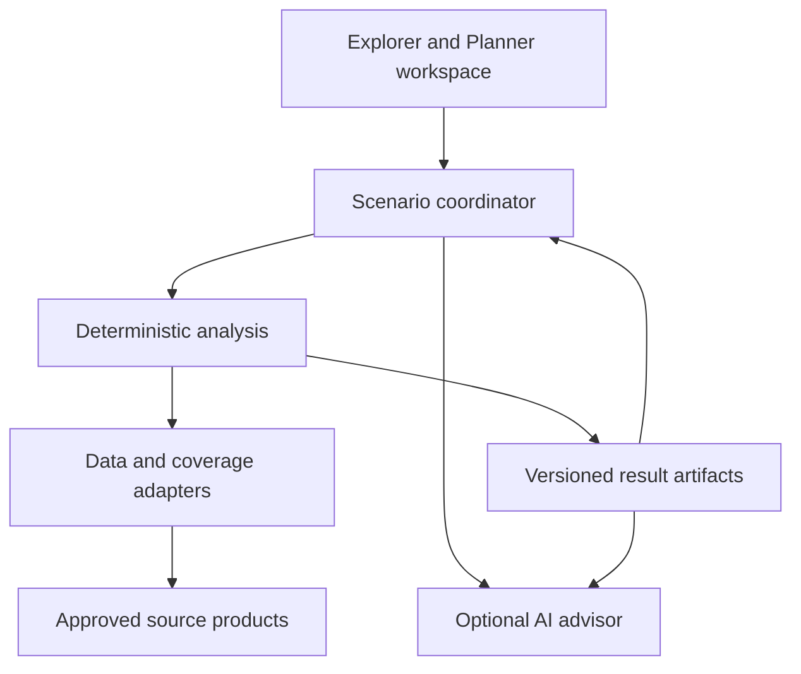

# Proposed system architecture

**Status: design proposal for team review.** The repository holds documentation and an in-progress mock-data viewer prototype in `web/`; no analysis pipeline, database, queue, or cloud service is implemented or provisioned by this design. Dataset scope, backend, hosting, providers, budgets, and delivery dates remain undecided.

Basis: [LunarSight V2 proposal](reference/proposal-v2.md), especially sections 3, 7–14 and the consistency issues in section 15. Related documents: [domain model](domain-model.md), [candidate API contracts](api-design.md), [data proposals](data-sources.md), and [operations](operations.md).

## Design objective

Connect a lunar location and mission configuration to understandable, reproducible evidence. Interactive Map, Local Horizon, Mission Feasibility Assessment, Mission Timeline, Scenarios, Sensitivity, AI Advisor, and Reports should refer to the same identified scenario and result.

The proposed starting shape is a modular application with clear internal boundaries, not necessarily separate deployed services. The broader backend, database and queue topology remains unselected.

**Prototype boundary (local-renderer cutover in progress, not verified):** the mock viewer maps to FR-005/006/007/008/010. UI code depends on `LunarDataProvider` (sites, terrain, horizon mask, ephemeris, with provenance). The accepted client is Vite + React + TypeScript + **local Three.js** ([ADR 0002](decisions/0002-mock-first-3d-web.md)). Terrain mesh generation runs in a dedicated browser Worker with transferred buffers; scalar heights remain available to unchanged science code. A finite curved patch replaces the global Cesium globe. A processed-data adapter, server, storage and hosting remain pending.

## Logical components

This is a proposed responsibility map. The sources, adapters, and artifacts in the diagram are future system elements; their presence does not claim acquisition or deployment.

| Boundary | Proposed responsibilities | Important exclusions |
| --- | --- | --- |
| Workspace | Scenario editing, map navigation, horizon/timeline presentation, comparison, sensitivity, EN/VI labels, accessible status display | It should not independently recalculate authoritative availability totals in each panel. |
| Scenario coordinator | Input validation, revision identity, coverage preflight, calculation requests, job state, result lookup, report requests | It should not replace unavailable observations with demonstration values. |
| Deterministic analysis | Defined geometry, terrain visibility, interval statistics, constraint evaluation, calculation provenance | Power budgets, radio links, eclipses, rover routing, and optimization are separate model choices. |
| Data and coverage adapters | Product metadata, source/version identity, footprint and validity checks, bounded access to selected assets | The adapter contract should not assume one resolution, frame, variable meaning, or coverage for every layer. |
| Result artifacts | Identified inputs, time series, metrics, constraints, method versions, uncertainty, validation evidence | A cached result must not silently change when source data or assumptions change. |
| Optional AI advisor | Explain an identified result, reference the evidence supplied, surface missing assumptions | It must not invent replacement scientific values or control deterministic pass/fail logic. |

## Proposed scenario flow

1. A user edits a scenario draft, selecting a catalog entry or coordinates, mission interval, height, and constraints.
2. The coordinator normalizes and validates the input without modifying its scientific meaning. Explicit start/end times and coordinate conventions become visible.
3. A coverage preflight reports which required and optional variables are supported, missing, uncertain, or outside the available products.
4. Once an analysis is requested, the coordinator freezes a scenario revision and its calculation identity. It reuses an exact matching result or starts a job.
5. The analysis reads only the necessary source region and time range, preserving variable definitions and quality metadata.
6. The result stores the scenario revision, calculation settings, source identities, summaries, and supporting series together.
7. All workspace views and exports consume that result. An advisor request cites the same result identity.

## Consistent interactive state

Separate the **editable draft**, **submitted revision**, **currently displayed result**, and **display time cursor**. Moving the cursor within a supported result selects a time sample; changing location, height, dates, constraints, or scientific method may require a new assessment or calculation.

A previous result may remain visible while a new request runs, but it should be labeled with its original settings and an explicit stale state. A late response from an older request must not replace the result for a newer active revision.

Loading a trial from Scenarios should transfer its complete advertised inputs. Sensitivity Reset should restore the identified baseline. A map layer's fixed display threshold and a mission profile's configurable threshold must remain distinct.

## Computation and caching proposal

Fast catalog and metadata operations may be served directly. Expensive horizon, time-series, and regional analyses should be designed as jobs with observable status and bounded resource use. The team must select an execution mechanism after deciding the initial analysis scope.

A result identity should include normalized coordinates, ground-height source or assumption, mast height, time interval, cadence, terrain/source versions, ephemeris kernels and frames, visibility convention, method version, and relevant numerical settings. Constraint evaluation also records its profile revision and thresholds. The choice to cache reusable geometry separately from assessments is an implementation decision.

Cancellation should distinguish a request to stop from an acknowledged cancellation. Completed artifacts should become discoverable atomically; an interrupted write must not be accepted as a valid cached result. Retry policy should distinguish transient source failures from unsupported inputs or missing scientific data.

No full-resolution, full-area, or hourly precomputation is assumed. Tile sizes, cache duration, concurrency, and storage limits require a bounded benchmark and team agreement.

## Coverage and result quality

Coverage is a first-class outcome. A location can have terrain data while a thermal or resource variable is unavailable. Known absence of a field is not necessarily a failed software job; the returned assessment can be explicitly partial.

Keep observations, published modeled products, project calculations, user assumptions, and demonstration values distinguishable. Scientific units, coordinate frames, temporal definitions, and validity masks should travel with the values. Regridding should preserve the source's information limits.

The JPL Tests view should show the reference value, computed value, residual definition, units, tolerance, and scope of each comparison. Agreement in an ephemeris reference case does not validate terrain obstruction, a power system, or mission safety.

## Optional persistence and collaboration

An initial experience could keep scenarios within one browser session, use local saved files, or use server-side persistence. Accounts, shared projects, and role-based access were not established by the prototype and are not selected here. The same domain identities should permit later persistence without requiring it now.

If shared storage is selected, ownership and access rules must accompany saved scenarios, results, and advisor conversations. A shared cache must respect those rules instead of assuming every input and output is public.

## Decisions needed before implementation

- Initial audience and accepted feature slice, including the intended meaning of preliminary feasibility.
- Geographic domain, chosen source products, resolutions, observation periods, and quality requirements.
- Numerical model scope, temporal cadence, visible-disc convention, and acceptable error evidence.
- Client rendering approach, server runtime, persistence, job execution, and hosting.
- Whether AI explanations, accounts, collaboration, and saved projects belong in the first build.
- Resource budgets and acceptance measurements for a bounded real-data example.

These decisions should be recorded before they become implementation assumptions. The [roadmap](roadmap.md) defines proposed sequencing; it is not evidence that these components already exist.
