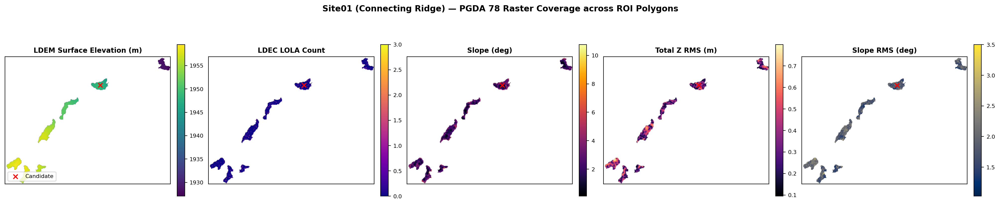

# Site01: kiểm tra raster trên ROI gốc

Ngày 14 November 2026. Mục đích: khảo sát coverage, chưa xác nhận nơi hạ cánh hoặc chất lượng khoa học của mô hình chân trời. [ROI và datum review](pilot-roi-datum-review.md) là phần phụ thuộc.

## Kết quả

Dùng bảy polygon gốc `Site01_ROIs.tgz` (SHA-256 `40b961417a344ce0274aecbab522e171a22f658507d82e8fb4d7bc97526ffc4f`). Đọc cửa sổ quanh union bounding box cho năm GeoTIFF PGDA 78. Raster hóa bằng quy tắc **tâm pixel nằm trong polygon**, `all_touched=False`: 2.197 pixel (tổng diện tích union ROI 52.825,0 m²). Các lớp có cùng grid/window (`[col 1466, row 1496, width 302, height 233]`) và cả năm đều có **2.197/2.197 pixel hữu hạn** trong mask đó.

| Lớp | Min–max trên 2.197 pixel | Median | Ý nghĩa |
| --- | ---: | ---: | --- |
| LDEM | 1927,068–1959,496 m | 1954,994 m | Cao độ bề mặt sản phẩm |
| LDEC | 0–3 | 0 | Số lượt LOLA trong pixel; 1.970/2.197 pixel có count 0, 227 có count > 0 |
| Slope | 0,105–10,763° | 2,325° | Lớp độ dốc chính thức của sản phẩm |
| Total Z RMS | 0,095–0,800 m | 0,329 m | Bất định cao độ của sản phẩm |
| Slope RMS | 1,028–3,501° | 1,872° | Bất định độ dốc của sản phẩm |

Count 0 là giá trị hợp lệ và không được coi là nodata; nó cho thấy không có lượt LOLA trực tiếp trong pixel đó, nhưng không phủ nhận DEM nội suy. Tỷ lệ hợp lệ chỉ áp dụng cho tập pixel được chọn theo tâm; không khẳng định toàn bộ pixel chạm polygon hoặc toàn vùng xung quanh đều hợp lệ. Không đặt ngưỡng an toàn từ các số này. Nguồn và metadata từng cửa sổ, hash mảng và dải HTTP trong [evidence](../notebooks/evidence/site01-roi-coverage.json). Các mảng mẫu nằm ở cache local bị Git bỏ qua, không commit toàn raster.

CRS shapefile và GeoTIFF có các tham số PROJ trùng nhau (south-polar stereographic, R=1.737.400 m), và phép biến đổi thử cho cùng X/Y; tuy nhiên `pyproj.CRS.equals` trả false. Tên datum/identifier chưa authoritative, nên đây là phép chồng lớp theo tham số được diễn giải, **chưa xác thực đầy đủ frame identity**. Đánh giá này không chứng minh vertical datum.

## Điểm kiểm thử đề xuất để nhóm xem

Trong 227 pixel có LDEC > 0, chọn pixel có tâm xa biên union ROI nhất theo khoảng cách phẳng: **X −10.797,5 m; Y −11.742,5 m**, tương ứng xấp xỉ **lat −89,47393424°, lon −137,40074627°**. Nó cách biên union ROI **30,0 m** (biên an toàn gấp đôi so với 15 m của Site04). Tại pixel này:
- Cao độ LDEM: **1948,353 m**
- Lượt quét LDEC: **1**
- Độ dốc Slope: **1,121°** (địa hình rất bằng phẳng)
- Total Z RMS: **0,173 m**
- Slope RMS: **1,789°**

Đây là **điểm kỹ thuật để minh họa và review**, không phải điểm đáp an toàn hay điểm đã chốt. Cách chọn chỉ tối đa hóa khoảng cách tới biên trong các tâm pixel có count > 0; không xét landing ellipse, chướng ngại vật, ánh sáng, horizon hay yêu cầu phương tiện. Điểm Data Book (-89.4632°, -137.49°) vẫn giữ nguyên trong cấu hình pilot cho đến khi nhóm quyết định thay đổi.

## Datum và Horizons

Tương tự Site04, [Barker et al. (2021)](https://ntrs.nasa.gov/api/citations/20205009660/downloads/Mike%20Barker_%20Paper_%20Improved%20Lola.pdf) mô tả surface height là elevation so với reference sphere 1.737,4 km. [README PGDA 78](https://pgda.gsfc.nasa.gov/data/LOLA_5mpp/README) mô tả Z mét và frame MOON_ME/DE421. Header Horizons ghi bán kính 1.737,4 km; [manual Horizons](https://ssd.jpl.nasa.gov/horizons/manual.html#center) yêu cầu observer altitude so với reference ellipsoid.

Những bằng chứng này thu hẹp nghi vấn, nhưng nguồn đã đọc chưa nêu trực tiếp bán kính **vertical reference sphere của riêng PGDA 78 Z**. Không suy từ map CRS sang vertical datum như một xác nhận độc lập. Giữ ellipsoid altitude của pilot là `null`; chỉ cộng 1 m AGL khi xác nhận được cùng reference surface và quyết định quy tắc lấy độ cao tại đúng observer. Giá trị 1948,353 m ở trên là một pixel minh họa, không phải observer altitude đã chọn.

## Tiếp theo

1. Nhóm review điểm minh họa của Site01 cùng với Site04 và quyết định có dùng điểm nội bộ ROI này làm observer kỹ thuật thay cho điểm Data Book lệch ngoài 91,3 m hay không.
2. Xác minh định danh frame và vertical datum tại nguồn gốc; sau đó mới tạo chuỗi Horizons cho observer Site01 được chọn.
3. Thiết lập chẩn đoán chân trời (horizon diagnostic) cho Site01 kết hợp DEM 5 m và DEM 80 m tương tự quy trình Site04.
