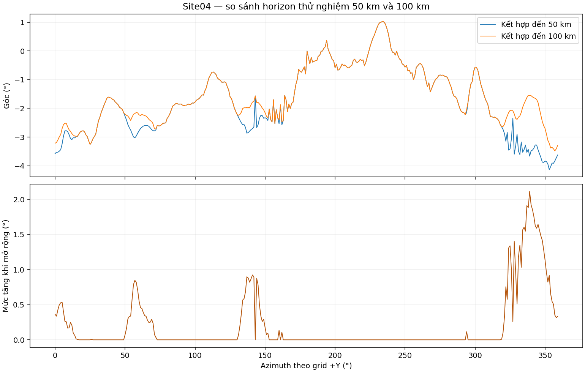

# Site04: kiểm tra horizon đến 100 km

Trạng thái: **phép thử có điều kiện**, không phải visibility hay đánh giá hạ cánh. Dựa trên observer kỹ thuật, giả định datum và phương pháp tại [báo cáo 50 km](site04-seam-convergence-review.md). Chưa có xác nhận vertical datum trực tiếp cho GeoTIFF PGDA 78; ROI/raster frame identity cũng còn mở.

## Phạm vi và kết quả

Miền gần giữ profile 5 m từ 5 m đến dưới 1 km; miền xa dùng PGDA 90 80 m từ 1 đến 100 km. Tại mỗi bin 1° theo **grid +Y**, lấy maximum của các tâm pixel trong nêm góc và giữa hai miền. Observer height là 1 m AGL trên pixel DEM với giả định cùng reference sphere. Khoảng dưới 5 m, seam 1 km, chuyển grid north sang local north, và sự khác biệt apparent/geometric vẫn chưa được xử lý để tính visibility.

| Kiểm tra | Kết quả |
| --- | ---: |
| Pixel 80 m hữu hạn trong annulus 1–100 km | 4.908.236 / 4.908.236 |
| Bin rỗng / bin có pixel thiếu trong annulus | 0 / 0 |
| Bin miền xa thay đổi khi tăng 50 → 100 km | 119 / 360 |
| Bin profile ghép thay đổi khi tăng 50 → 100 km | 106 / 360 |
| Mức tăng lớn nhất của profile ghép | 2,113° |
| Cực đại miền xa ở đoạn 90–100 km | 70 / 360 bin |
| Trong số đó, miền xa lớn hơn hoặc bằng miền gần | 70 / 360 bin |

Một cực đại ở 90–100 km không chứng minh địa hình ngoài 100 km chắc chắn sẽ thay đổi profile, nhưng cho thấy cần kiểm tra tiếp trước khi tuyên bố hội tụ. Tính hợp lệ của pixel không xác nhận vertical datum, độ chính xác DEM hoặc nguồn chiếu sáng.

## Bằng chứng và giới hạn

Cửa sổ 50 km lưu trước đó khớp **từng giá trị pixel** với subset tương ứng của cửa sổ 100 km mới. Profile 25 km và 50 km theo từng bin khớp evidence cũ, và maxima của các vòng lồng nhau không giảm. Bản 100 km có một lần đọc nguồn thành công; **chưa chạy lại toàn bộ lượt đọc 100 km lần thứ hai**. 27.262.976 bytes HTTP response body đã được đọc trong lượt thành công, không phải dung lượng toàn raster.

- [Profile miền xa 100 km](../notebooks/evidence/site04-case/horizon-80m-100km.csv) và [metadata](../notebooks/evidence/site04-case/horizon-80m-100km-metadata.json).
- [Profile ghép 100 km](../notebooks/evidence/site04-case/near-far-100km.csv) và [metadata](../notebooks/evidence/site04-case/near-far-100km-metadata.json).
- [Script bounded 100 km](../analysis/site04_100km_diagnostic.py), [script ghép](../analysis/site04_combine_100km.py), [offline checks](../analysis/check_site04_100km.py). Script giới hạn response body 48 MiB; cache gốc bị Git bỏ qua.

Lần đối chiếu vector cầu trong báo cáo 50 km chỉ sử dụng cùng terrain, sphere và observer; nó không phải reference địa hình độc lập. Tiếp tục cần benchmark bên ngoài, xác minh datum/frame, xử lý near-field và tiêu chí horizon/timing trước khi phát hành visibility.
