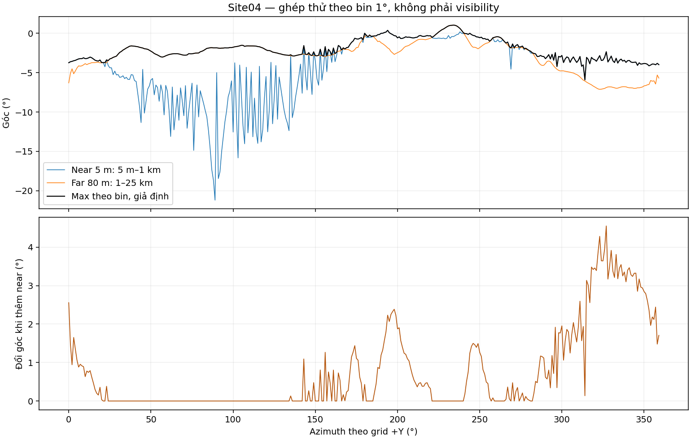

# Site04 — ghép thử địa hình gần 5 m và miền xa 80 m

Trạng thái: **thử nghiệm kỹ thuật có điều kiện**; không phải horizon hội tụ, visibility nhiệm vụ, hoặc đánh giá hạ cánh. Kế thừa observer và giả định vertical datum từ [case Horizons/horizon](site04-observer-diagnostic.md), không thay `pilot-v1`.

## Phương pháp

- Điểm thử cố định tại tâm pixel PGDA 78 X −2652,5 m / Y −5952,5 m; Z gần nhất 1737,1783447265625 m, cao observer 1 m AGL. Z-to-ellipsoid của riêng PGDA 78 vẫn là giả định chưa được xác nhận trực tiếp.
- Miền gần: PGDA 78 5 m, các tâm pixel cách observer **≥5 m và <1.000 m**. Miền xa: profile PGDA 90 80 m từ **1.000–25.000 m** đã lưu trong PR #9. Cả hai giữ cùng observer, xấp xỉ độ cong, bin 1° theo grid +Y; lấy maximum của hai thành phần trong mỗi bin.
- Đây là **maximum trên các tâm pixel trong một nêm góc 1°**, không phải ray tracing chính xác theo một tia. Hai cực đại gần/xa trong cùng bin có thể ở hai azimuth khác nhau. Khoảng dưới 5 m, địa hình dưới độ phân giải và giới hạn 25 km vẫn chưa được giải quyết.
- Không resample hoặc làm trơn giữa hai DEM; không áp vertical bias correction khi chưa có cơ sở. Các giá trị Z được giả định dùng cùng reference sphere. Phép so sánh chồng phủ nearest-cell ở dưới chỉ là kiểm tra ban đầu; cần đánh giá resampling/point-spread và sai số giữa sản phẩm trước khi xem phép ghép là mô hình khoa học.
- Hai GeoTIFF cho tham số PROJ cùng stereographic/sphere 1737400 m, nhưng so sánh semantic CRS của chúng trả false; đây là phép ghép dưới giả định frame giống nhau, không xác minh authoritative frame identity. Source PGDA mô tả các raster theo MOON_ME / DE421: [PGDA 78](https://pgda.gsfc.nasa.gov/products/78), [PGDA 90](https://pgda.gsfc.nasa.gov/products/90).
- Một bin được báo kết quả chỉ khi số ô hợp lệ bằng tổng ô trong miền gần và miền xa của bin. Không thay nodata bằng 0 hoặc để lớp kia che giấu dữ liệu thiếu.

## Kết quả lần chạy đầu

Trong annulus 5–1000 m: **125.608/125.608 tâm pixel hợp lệ**, không bin rỗng hay bin có dữ liệu thiếu. Profile miền xa trước đó có đủ 360 bin trên vùng 1–25 km. Phép maximum theo bin có **360/360 bin khả dụng**. Trong case này miền gần lớn hơn miền xa ở 186 bin, miền xa lớn hơn miền gần ở 174 bin; chênh `max(gần,xa) − xa` cao nhất khoảng **4,55°**. Đây là khác biệt của thuật toán thử, không phải p95 uncertainty hay sai số thực tế.

Ở miền xa, 82/360 peak trước đó nằm trong 10% ngoài cùng của 25 km. Thêm miền gần không chứng minh đã hội tụ ở xa; các bin có miền gần lớn hơn miền xa vẫn có thể bị địa hình ngoài 25 km vượt qua. Không so góc này trực tiếp với Horizons apparent azimuth/elevation vì chưa chuyển grid north sang hướng local tương ứng, chưa xử lý apparent/geometric và chưa validate observer datum.

Evidence: [CSV 360 bin](../notebooks/evidence/site04-case/near-far-25km.csv), [metadata/hash](../notebooks/evidence/site04-case/near-far-25km-metadata.json), [script bounded](../analysis/site04_nearfield_diagnostic.py). Các file nguồn không được commit. Một lượt đọc lại cho cùng window/hash và CSV giống byte; script cũng kiểm tra observer đúng tâm pixel và Z 5 m, so sánh tham số phép chiếu; read HTTP Range giới hạn 24 MiB và output mới nằm trong `artifacts/site04-nearfield/`. ETag/hash lưu provenance, không phải checksum do NASA công bố.

## Kiểm tra chồng phủ gần seam

Trong vành 800–975 m quanh observer, lấy 153 tâm pixel 80 m và so với pixel 5 m chứa từng tâm; cả 153 cặp có giá trị hữu hạn. Khoảng cách lớn nhất giữa hai tâm pixel là 3,536 m. Hiệu `Z5m − Z80m`: median **−0,208 m**, mean **−0,500 m**, p95 của trị tuyệt đối **2,732 m**, lớn nhất tuyệt đối **9,563 m**. Đây là thống kê độ cao, không phải p95 của góc horizon hay tolerance được chấp nhận.

Hai grid khác độ phân giải và footprint mẫu; nearest-cell không phải averaging/đồng đăng ký ở cùng effective resolution. Các số này không chứng minh bias, sai số tuyệt đối hay datum đúng. Không tự áp hiệu chỉnh cao độ. [CSV từng cặp](../notebooks/evidence/site04-case/overlap-800-975m.csv), [metadata/hash](../notebooks/evidence/site04-case/overlap-800-975m-metadata.json), [script](../analysis/site04_overlap_diagnostic.py) ghi rõ quy tắc, annulus và hash của hai cửa sổ.

## Datum và bước còn lại

[PGDA 78](https://pgda.gsfc.nasa.gov/products/78) ghi surface height Z và frame; [Barker et al.](https://ntrs.nasa.gov/api/citations/20205009660/downloads/Mike%20Barker_%20Paper_%20Improved%20Lola.pdf) mô tả height so với reference sphere. Các chuẩn LOLA của NASA/USGS hỗ trợ sphere 1737,4 km, nhưng phần tài liệu đã kiểm tra vẫn không gắn bán kính vertical reference trực tiếp với GeoTIFF Site04 PGDA 78. Không đổi trạng thái datum sang verified chỉ từ WKT bản đồ.

Tiếp theo: (1) xác minh vertical datum/frame trực tiếp; (2) đánh giá overlap 5 m/80 m ở cùng effective resolution và uncertainty tại vùng chuyển tiếp 1 km; (3) mở rộng miền xa theo nhu cầu và kiểm tra hội tụ/edge; (4) so với reference độc lập hoặc mô hình hình học kiểm chứng; (5) xác định chuyển grid azimuth sang local north và geometric/apparent trước khi tính visibility. Giữ observer kiểm thử và các tham số tách khỏi lựa chọn site đáp.
