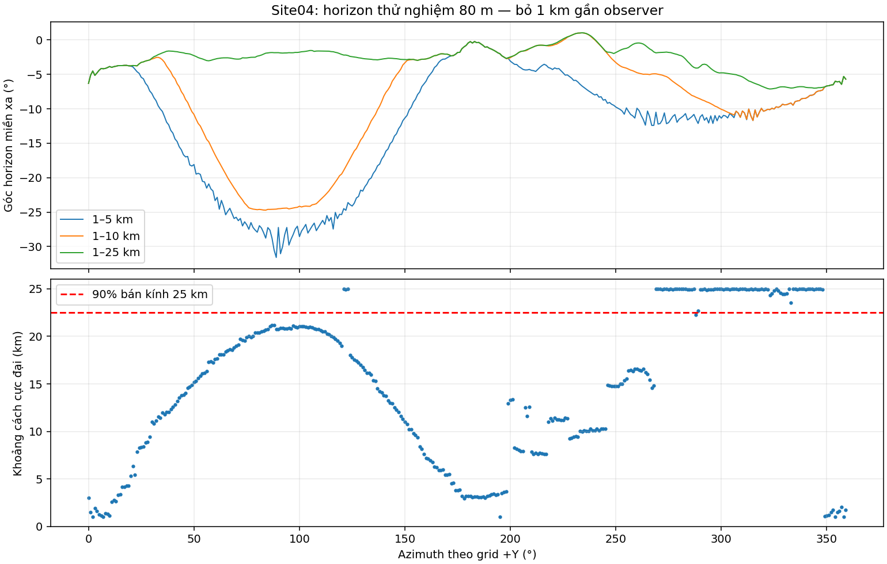

# Site04 observer — phép thử Horizons và horizon

Trạng thái: **thử nghiệm có điều kiện, không phải kết quả nhiệm vụ đã xác minh**. User yêu cầu xác định thực hành phù hợp và tiếp tục case sau [ROI coverage](site04-roi-coverage.md). Observer kỹ thuật là tâm pixel X −2652,5 / Y −5952,5 m, lat −89,78509165766015°, east longitude −155,98171723291347°. Đây là điểm minh họa trong ROI, không thay `pilot-v1` và không phải landing approval; chỉ cách biên khoảng 15 m.

## Datum, frame và sampling

PGDA 78 mô tả Z là surface height mét và frame MOON_ME/DE421. Tài liệu [Barker et al.](https://ntrs.nasa.gov/api/citations/20205009660/downloads/Mike%20Barker_%20Paper_%20Improved%20Lola.pdf) mô tả surface height trên reference sphere. [NASA LOLA SIS](https://science.nasa.gov/wp-content/uploads/2024/01/lola-rdrsis.pdf) và [USGS lunar data standards](https://psdi.astrogeology.usgs.gov/moon/standards/data_standards/) mô tả reference sphere 1737,4 km và ME/DE421 cho dữ liệu LOLA; đây là bằng chứng hỗ trợ theo họ sản phẩm, chưa phải một label vertical datum độc lập, rõ ràng cho chính GeoTIFF PGDA 78 Site04. CRS shapefile/raster có tham số PROJ khớp nhưng semantic equality false.

Vì vậy case này **giả định**, chưa xác nhận độc lập, rằng Z của PGDA 78 dùng cùng sphere 1737,4 km với Horizons. Nearest-cell Z tại tâm pixel là 1737,1783447265625 m; 1 m AGL cho ellipsoid altitude giả định 1,7381783447265625 km. Nếu giả định sai, các kết quả phụ thuộc observer altitude phải tính lại. Không cập nhật `ellipsoid_altitude_m` của pilot-v1. Việc 1 pixel có LDEC=1 không chứng minh vị trí footprint của lượt đo nằm đúng tâm pixel.

## Horizons

Các response gốc [Sun](../notebooks/evidence/site04-case/sun.json) và [Earth](../notebooks/evidence/site04-case/earth.json) được tạo với `coord@301`, geodetic, observer giả định ở trên, target 10/399, 2027-01-01 00:00 đến 2027-02-01 00:00, bước 1 h, quantity 4, CSV. Script [site04_horizons_probe.py](../analysis/site04_horizons_probe.py) ghi lần chạy mới vào `artifacts/site04-case`, không ghi đè response được lưu trong Git. Xem [Horizons API](https://ssd-api.jpl.nasa.gov/doc/horizons.html).

Cả hai response có 745 hàng, gồm hai đầu mút; pilot khoảng đóng–mở `[start,end)` sử dụng **744 hàng**, loại mẫu `2027-02-01 00:00` khi tính thống kê. Header cả hai xác nhận `Center pole/equ: MEAN_ME (high precision)`, longitude dương hướng đông và `Center radii: 1737.4, 1737.4, 1737.4 km`. Horizons chuẩn hóa longitude âm thành 204,0182828° east. Quantity 4 là azimuth/elevation **airless apparent**; không tự gọi nó là geometric hay visibility có terrain. Chưa tính cửa sổ chiếu sáng, chưa kiểm tra event timing hoặc benchmark độc lập.

SHA-256 raw JSON: Sun `17c324e1eb4b7d056c707ed5ad0b573ac3e396928b0ef006845dc512d26ce9c0`; Earth `7d7020a53414280035b76f67087088d9b6579abc6d24dd072b4ea0a95020b13b`. Hash xác định response đã lưu, không bảo đảm một lần truy vấn sau trả cùng header/timestamp. Lần chạy lại script đã trả cùng 745 dòng dữ liệu cho từng target; raw JSON hash thay đổi trong khi bảng dữ liệu giống nhau, vì vậy raw hash khác không tự chứng minh số liệu đã thay đổi.

## Horizon 80 m: thử nghiệm miền xa

Kết quả [profile theo 360 bin](../notebooks/evidence/site04-case/horizon-80m.csv) và [metadata đầu vào](../notebooks/evidence/site04-case/horizon-80m-metadata.json) được lưu cùng [script tái chạy](../analysis/site04_horizon_diagnostic.py). Vùng 1–5 km có 11.778/11.778 ô hợp lệ; 1–10 km có 48.599/48.599; 1–25 km có 306.315/306.315. Không có bin rỗng hoặc bin có nodata trong các vòng này. Maxima của 360 bin không giảm khi mở rộng từng vòng. Kiểm tra độc lập CSV và tổng số ô khớp metadata.

Với bán kính 25 km, **82/360 bin** có điểm cực đại nằm ở đoạn 22,5–25 km ngoài cùng. Các hướng đó có thể còn phụ thuộc bán kính: kết quả này chưa chứng minh hội tụ. Số byte HTTP thành công trong lượt đọc cửa sổ được ghi là 6.291.456 bytes; nó không phải dung lượng raster đầy đủ.

**Điều chỉnh provenance:** lần chạy đầu vô tình ghi dòng CSV cuối vào trường window row do trùng tên biến. Đọc lại từ nguồn cho cùng SHA-256 mảng, xác nhận window `[3454, 3561, 626, 626]`; metadata đã sửa và script đổi tên biến. CSV profile và hash mảng không thay đổi. Lượt chạy lại script đã sửa đọc lại nguồn, xác nhận cùng window/hash và tạo CSV khớp evidence đã lưu sau chuẩn hóa line ending LF để tái lập trên Git.

Phương pháp và giới hạn: LDEM PGDA 90 80 m, observer Z theo giả định ở trên, một grid, cùng mask và bin azimuth 1°; so sánh maxima trên ba vòng lồng nhau. Khoảng cách là Euclid trên mặt phẳng chiếu, azimuth theo grid +Y, chưa hiệu chỉnh hội tụ kinh tuyến; công thức xấp xỉ độ cong `atan2(z_cell-z_observer-d²/(2R), d)`. **Bỏ mọi địa hình dưới 1 km** để tránh diễn giải sai near-field do 80 m; vì vậy profile là miền xa, không phải full horizon, không dùng trực tiếp để kết luận Sun/Earth visibility. Những bin thiếu dữ liệu và khoảng cách cực đại phải được kiểm tra cùng kết quả. Thuật toán còn cần reference độc lập và đối chiếu mô hình hình học chính xác.

Các bán kính 5/10/25 km dùng cùng điểm và phép tính; kiểm tra maxima không giảm khi mở rộng vòng trong các bin chung. Điều này là kiểm tra tính nhất quán cần thiết, không chứng minh độ chính xác hay 25 km đủ xa. Kiểm tra riêng địa hình cầu phẳng, observer cao 1 m, so công thức xấp xỉ với công thức hình học cầu lượng giác tại 1/5/10/25 km cho sai khác lớn nhất khoảng 0,0000072°; phép kiểm này không bao phủ projection/grid hay dữ liệu địa hình thực. Không sử dụng các p95 lịch sử chưa tái lập để chọn threshold hoặc sản phẩm.

## Trước khi đưa vào ứng dụng

- Nhóm xác nhận observer/ROI hoặc tiếp tục dùng điểm Data Book; cả hai đều chưa là landing approval.
- Xác minh trực tiếp vertical datum của Z PGDA 78 và frame identity của ROI; tái chạy nếu giả định thay đổi.
- Bổ sung near-field 5 m, xử lý chuyển tiếp grid/mask và terrain coverage tới khoảng cách hội tụ; kiểm tra reference độc lập.
- Chốt định nghĩa geometric/apparent, độ cao, ngưỡng thời gian và xử lý thiếu dữ liệu trước khi tạo visibility windows.
