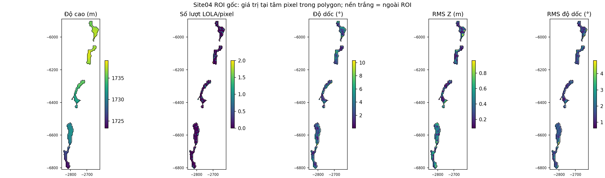

# Site04: kiểm tra raster trên ROI gốc

Ngày 14 November 2026. Mục đích: khảo sát coverage, chưa xác nhận nơi hạ cánh hoặc chất lượng khoa học của mô hình chân trời. [ROI và datum review](pilot-roi-datum-review.md) là phần phụ thuộc.

## Tái lập

Xem [notebook tái lập ROI Site04](../notebooks/site04-roi-reproduction.ipynb). Notebook kiểm tra hash archive ROI và các cửa sổ với evidence đã review, dựng lại mask và điểm minh họa. Output được nhúng để xem; chạy trên máy mới cần cài các thư viện nêu trong notebook và đặt `SITE04_FETCH_REMOTE=1` để đọc archive nhỏ cùng các HTTP Range có giới hạn. Cache nằm ngoài Git. Lượt chạy tái lập ngày 14 November 2026 đã tải lại archive và năm cửa sổ từ nguồn; hash và mask khớp evidence đã lưu, đồng thời chạy lại thành công từ cache. Nếu hash nguồn thay đổi, notebook dừng để yêu cầu review chứ không ghi đè evidence.

## Kết quả

Dùng bốn polygon gốc `Site04_ROIs.tgz` (SHA-256 `8e8b788f9fdf6400f23fd36dad02138102bd1a905b4b71a5739a9a4fd8a0e07a`). Đọc cửa sổ quanh union bounding box cho năm GeoTIFF PGDA 78. Raster hóa bằng quy tắc **tâm pixel nằm trong polygon**, `all_touched=False`: 526 pixel. Các lớp có cùng grid/window và cả năm đều có **526/526 pixel hữu hạn** trong mask đó.

| Lớp | Min–max trên 526 pixel | Ý nghĩa |
| --- | ---: | --- |
| LDEM | 1723,328–1739,122 m | Cao độ sản phẩm |
| LDEC | 0–2 | Số lượt LOLA trong pixel; 468/526 pixel có count 0, 58 có count > 0 |
| Slope | 0,052–10,325° | Lớp slope chính thức của sản phẩm |
| Total Z RMS | 0,088–0,962 m | Bất định cao độ của sản phẩm |
| Slope RMS | 0,643–4,818° | Bất định độ dốc của sản phẩm |

Count 0 là giá trị hợp lệ và không được coi là nodata; nó cho thấy không có lượt LOLA trong pixel đó, không phủ nhận DEM nội suy. Tỷ lệ hợp lệ chỉ áp dụng cho tập pixel được chọn theo tâm; không khẳng định toàn bộ pixel chạm polygon hoặc toàn vùng xung quanh đều hợp lệ. Không đặt ngưỡng an toàn từ các số này. Nguồn và metadata từng cửa sổ, hash mảng và dải HTTP trong [evidence](../notebooks/evidence/site04-roi-coverage.json). Các mảng mẫu nằm ở cache local bị Git bỏ qua, không commit toàn raster.

CRS shapefile và GeoTIFF có các tham số PROJ trùng nhau (south-polar stereographic, R=1.737.400 m), và phép biến đổi thử cho cùng X/Y; tuy nhiên `pyproj.CRS.equals` trả false. Tên datum/identifier chưa authoritative, nên đây là phép chồng lớp theo tham số được diễn giải, **chưa xác thực đầy đủ frame identity**. Đánh giá này không chứng minh vertical datum.

## Điểm kiểm thử đề xuất để nhóm xem

Trong 58 pixel có LDEC > 0, chọn pixel có tâm xa biên union ROI nhất theo khoảng cách phẳng: **X −2652,5 m; Y −5952,5 m**, tương ứng xấp xỉ **lat −89,78509166°, lon −155,98171723°**. Nó thuộc polygon record index 3 (zero-based), cách biên khoảng 15 m. Tại pixel: DEM 1737,178 m; LDEC 1; slope 2,284°; Z RMS 0,136 m; slope RMS 1,071°.

Đây là **điểm kỹ thuật để minh họa và review**, không phải điểm đáp an toàn hay điểm đã chốt. Cách chọn chỉ tối đa hóa khoảng cách tới biên trong các tâm pixel có count > 0; không xét landing ellipse, chướng ngại vật, ánh sáng, horizon hay yêu cầu phương tiện. Điểm Data Book vẫn giữ nguyên trong cấu hình pilot cho đến khi nhóm quyết định thay đổi.

## Datum và Horizons

[Barker et al. (2021)](https://ntrs.nasa.gov/api/citations/20205009660/downloads/Mike%20Barker_%20Paper_%20Improved%20Lola.pdf) mô tả surface height là elevation so với reference sphere. [README PGDA 78](https://pgda.gsfc.nasa.gov/data/LOLA_5mpp/README) mô tả Z mét và frame MOON_ME/DE421; GeoTIFF map CRS ghi sphere 1.737.400 m. Header Horizons đã kiểm tra trước ghi bán kính 1.737,4 km; [manual Horizons](https://ssd.jpl.nasa.gov/horizons/manual.html#center) yêu cầu observer altitude so với reference ellipsoid.

Những bằng chứng này thu hẹp nghi vấn so với báo cáo trước, nhưng nguồn đã đọc chưa nêu trực tiếp bán kính **vertical reference sphere của riêng PGDA 78 Z**. Không suy từ map CRS sang vertical datum như một xác nhận độc lập. Giữ ellipsoid altitude của pilot là `null`; chỉ cộng 1 m AGL khi xác nhận được cùng reference surface và quyết định quy tắc lấy độ cao tại đúng observer. Giá trị 1737,178 m ở trên là một pixel minh họa, không phải observer altitude đã chọn.

## Tiếp theo

Nhóm review point minh họa và chọn observer/ROI hoặc giữ điểm Data Book cho kiểm thử. Xác minh định danh frame và vertical datum tại nguồn gốc; sau đó mới tạo chuỗi Horizons cho observer được chọn. Tái lập horizon và lưu per-azimuth evidence trước khi dùng p95/độ phân giải hoặc tuyên bố hội tụ.
