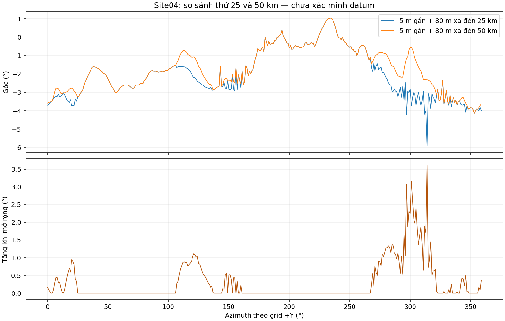

# Site04 — kiểm tra seam và hội tụ 50 km

Trạng thái **chẩn đoán có điều kiện**, kế thừa observer kỹ thuật và giả định datum từ [case 25 km](site04-observer-diagnostic.md) và [ghép gần/xa](site04-near-far-review.md). Đây không phải visibility nhiệm vụ hoặc đánh giá nơi đáp.

## 1. So sánh 5 m và 80 m theo cùng footprint

Dùng cùng hai cửa sổ đã ghi hash trong PR #9/#10. Với mỗi tâm pixel 80 m trong vành **800–930 m** quanh observer, tính trung bình các pixel 5 m giao footprint 80 × 80 m theo trọng số diện tích trên mặt phẳng chiếu. Chỉ giữ footprint có đủ dữ liệu cả hai lớp: **111/111 ô**.

| Thống kê Z trung bình 5 m trừ Z 80 m | Giá trị |
| --- | ---: |
| Median | −0,258 m |
| Mean | −0,209 m |
| P95 của trị tuyệt đối | 0,735 m |
| Lớn nhất tuyệt đối | 1,739 m |

GDAL `Resampling.average` được dùng làm phép kiểm độc lập cho phép tính diện tích: cả 111 ô khớp với sai khác số học tối đa **0,000061 m**. Đây là kiểm chứng cách tính trên cùng input, không phải sai số của DEM.

Cùng footprint hình học **chưa đảm bảo cùng effective resolution**: các DEM có kernel, interpolation và mẫu LOLA khác nhau; chưa đối chiếu uncertainty hoặc đăng ký frame đầy đủ. Các số này không chứng minh vertical datum hay bias nguồn. Không tự áp offset. Phép nearest-cell trước dùng vành 800–975 m, nên không so trực tiếp hai bảng như một thí nghiệm cùng mẫu. [CSV từng ô](../notebooks/evidence/site04-case/overlap-area-800-930m.csv), [metadata](../notebooks/evidence/site04-case/overlap-area-800-930m-metadata.json).

## 2. Mở rộng 80 m đến 50 km

Cùng observer, DEM, mask, phép xấp xỉ độ cong và bin grid-azimuth 1°; miền xa vẫn bỏ khoảng dưới 1 km. Có **1.226.698/1.226.698 pixel hữu hạn** trong annulus 1–50 km; 360 bin đều có dữ liệu. Vùng raster 25 km cũ khớp chính xác với subset của cửa sổ 50 km; profile 25 km theo từng bin được tái lập. Một lượt đọc lại 50 km xác nhận hash/window và profile tương ứng. Maxima theo các bán kính lồng nhau không giảm.

- Profile **miền xa** thay đổi ở 165/360 bin khi tăng 25 → 50 km; mức tăng lớn nhất khoảng 4,212°.
- Sau khi lấy maximum với thành phần gần 5 m, profile **ghép** thay đổi ở 134/360 bin; mức tăng lớn nhất khoảng 3,617°.
- Có **80/360** cực đại miền xa nằm trong 45–50 km; trong đó 55 hướng có miền xa lớn hơn hoặc bằng miền gần trong profile ghép. Đây là dấu hiệu cần tiếp tục xem xét vùng xa, không chứng minh địa hình ngoài 50 km chắc chắn thay đổi kết quả.

Không tuyên bố hội tụ tại 50 km. Các bin là maximum trên một nêm 1°, không phải trace một tia. Phạm vi dưới 5 m, quy tắc ghép gần/xa và frame/datum vẫn có giới hạn như trước. [Profile 80 m](../notebooks/evidence/site04-case/horizon-80m-50km.csv), [metadata](../notebooks/evidence/site04-case/horizon-80m-50km-metadata.json), [profile ghép](../notebooks/evidence/site04-case/near-far-50km.csv), [metadata ghép](../notebooks/evidence/site04-case/near-far-50km-metadata.json).

## 3. Phép đối chiếu hình học độc lập ở mức công thức

Trên **cùng pixel 80 m, cùng mask 1–25 km**, tính elevation theo vector 3D trên mặt cầu và azimuth bắc địa phương; so với công thức xấp xỉ mặt phẳng/độ cong trên đúng các bin bắc địa phương đó. Trên 360 bin, median sai khác tuyệt đối khoảng **0,00120°**, p95 khoảng **0,00455°**, lớn nhất khoảng **0,00857°**. Đây là sai khác hai cách tính hình học dưới cùng sphere, dữ liệu và observer giả định; không phải sai số datum, DEM hay benchmark khoa học độc lập. Nó không kiểm tra near-field 5 m hoặc đoạn 25–50 km.

Lưu ý các bin trong phép kiểm này dùng **bắc địa phương**, còn CSV horizon cũ dùng **grid +Y**; không ghép hai bảng theo cùng số bin. [CSV đối chiếu](../notebooks/evidence/site04-case/spherical-crosscheck.csv), [metadata](../notebooks/evidence/site04-case/spherical-crosscheck-metadata.json).

## Kết luận thực hành và việc tiếp theo

1. Giữ 5 m/80 m là case thăm dò; chưa chọn seam hay hiệu chỉnh Z chính thức từ 111 ô. So sánh effective resolution, uncertainty/count và footprint trên vùng chồng phủ rộng hơn trước.
2. Giữ 50 km là bán kính thử; nhóm cần mục tiêu hội tụ/tolerance và tiếp tục kiểm tra các hướng còn ở biên. Không mặc định tải toàn bộ vùng cực.
3. Cần xác minh trực tiếp vertical datum PGDA 78 và frame identity, chọn observer kỹ thuật, ghép near-field với xử lý thiếu dữ liệu và đối chiếu một reference độc lập trước khi tính visibility.
4. Các script và thứ tự chạy ở [analysis README](../analysis/README.md). Dữ liệu gốc/crop nằm trong cache Git-ignored; CSV profile, hash và metadata được giữ để review.
