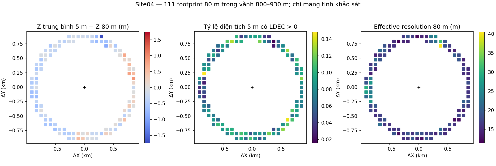

# Site04: chất lượng dữ liệu ở vùng chuyển tiếp 5 m / 80 m

Trạng thái **khảo sát cục bộ** ngày 14 November 2026; kế thừa observer, grid và giả định trong [báo cáo seam 50 km](site04-seam-convergence-review.md). Khung được kiểm tra là 111 footprint 80×80 m có tâm cách observer 800–930 m. Không coi đây là ROI Site04 đầy đủ, đánh giá an toàn hoặc xác nhận datum.

## Các lớp đã đọc

Từ PGDA 78: LDEC và Z RMS 5 m. Từ PGDA 90: LDEC, effective resolution và Z error 80 m. Các cửa sổ được đọc bằng HTTP Range có giới hạn; grid transform của từng lớp được đối chiếu với DEM cùng nguồn, các tham số phép chiếu PROJ được đối chiếu nhưng semantic CRS/frame giữa hai sản phẩm vẫn chưa được xác nhận authoritative. Chỉ commit [CSV từng footprint](../notebooks/evidence/site04-case/seam-quality.csv) và [metadata nguồn/hash/range](../notebooks/evidence/site04-case/seam-quality-metadata.json); cache arrays bị Git bỏ qua.

| Kiểm tra trên 111 footprint | Kết quả min / median / max |
| --- | --- |
| Tỷ lệ diện tích 5 m có LDEC > 0 trong từng footprint | 1,56% / 7,81% / 14,84% |
| Trung bình diện tích các giá trị Z RMS 5 m | 0,263 / 0,414 / 0,878 m |
| LDEC 80 m | 6 / 21 / 40 lượt trên pixel |
| Effective resolution 80 m | 11,379 / 16,771 / 40,487 m |
| Z error 80 m | 0,049 / 0,083 / 0,364 m |

Cả 111 footprint có đủ 6.400 m² giá trị hữu hạn ở lớp count và Z RMS 5 m; ba lớp 80 m cũng có giá trị tại cả 111 ô. **LDEC=0 là giá trị hợp lệ**: diện tích 5 m không có lượt trực tiếp không đồng nghĩa pixel DEM không hợp lệ; DEM có thể nội suy. Các lượt ở hai bộ sản phẩm không nhất thiết tương đương từng footprint và chưa được xác nhận là độc lập.

Trung bình diện tích của các giá trị RMS là thống kê mô tả lớp RMS trên footprint; **không phải bất định của cao độ trung bình**. Không gộp RMS 5 m và Z error 80 m theo căn tổng bình phương khi chưa biết covariance, mô hình lỗi và tương quan giữa các nguồn.

PGDA 90 ghi `EFFRES` theo mét. Barker et al. định nghĩa effective resolution theo khoảng trống giữa các dấu LOLA: đường kính đặc trưng lớn nhất có thể không được spot lấy mẫu. Nó không tự là kích thước pixel, PSF/kernel dùng để làm mờ, hay bằng chứng hai DEM có cùng effective resolution. Vì vậy các giá trị nhỏ hơn pixel 80 m không có nghĩa DEM lưới 80 m biểu diễn độc lập chi tiết ở cỡ đó. [PGDA 90](https://pgda.gsfc.nasa.gov/products/90), [Barker et al. (2023)](https://ntrs.nasa.gov/api/citations/20230014419/downloads/BarkernewviewSTIupdated.pdf).

## Kiểm tra và tái lập

[Script seam quality](../analysis/site04_seam_quality.py) kiểm transform của từng lớp so với DEM baseline tương ứng, giữ scale/offset/nodata, kiểm hash cache và từ chối nguồn khác evidence đã lưu. Đặt `SITE04_FETCH_QUALITY=1` để lấy cửa sổ còn thiếu; mặc định dùng cache, không gọi mạng. Một lượt chạy từ nguồn và một lượt chạy lại từ cache đã cho CSV giống byte. [Kiểm tra độc lập bằng GDAL average](../analysis/check_site04_seam_quality.py) xác nhận cả 111 ô: sai khác số học lớn nhất 0 cho tỷ lệ LDEC > 0 và khoảng 0,00000003 m cho trung bình lớp RMS; không xác nhận datum hay mô hình lỗi. Script chỉ yêu cầu bounded window; có thể truyền nhiều byte hơn kích thước crop do layout raster.

Chất lượng ở 111 footprint seam bổ sung cho phép area-average 5 m/80 m, nhưng chưa tạo kernel tương đương, chưa hiệu chỉnh frame/datum và chưa lan truyền uncertainty vào horizon. Không rút ra ngưỡng p95/hội tụ từ bảng này.

## Cần làm tiếp

1. Thiết kế so sánh support/kernel được nguồn giải thích hoặc đánh giá sensitivity với nhiều phương pháp aggregation; ghi rõ giới hạn của EFFRES.
2. Dùng uncertainty/clones với phương pháp có xét tương quan để ước lượng biến thiên horizon; không xem RMS area mean là sai số của mean.
3. Tiếp tục kiểm tra horizon xa và reference độc lập. Với pipeline đầu vào, có thể bắt đầu thiết kế contract/prototype song song theo [roadmap DE](de-pipeline-roadmap.md); không cần đợi horizon được scientific validation mới thiết kế ingestion.
